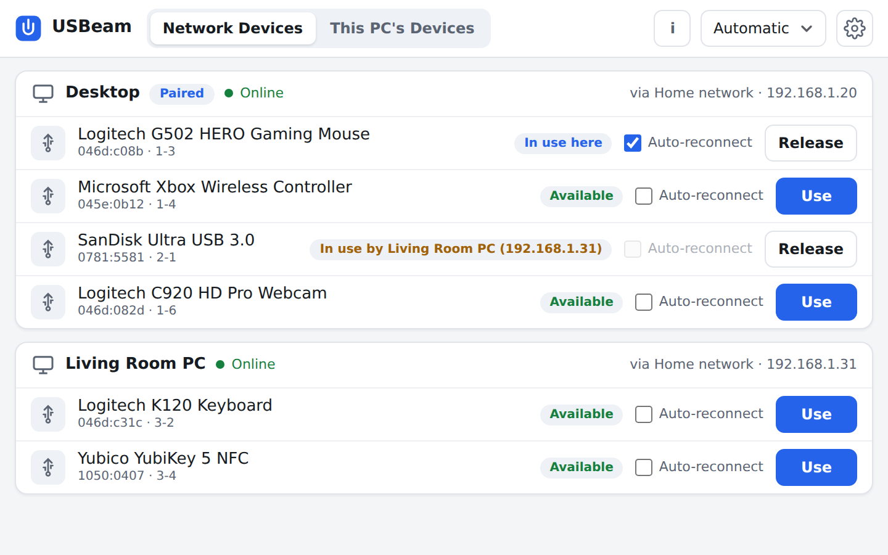
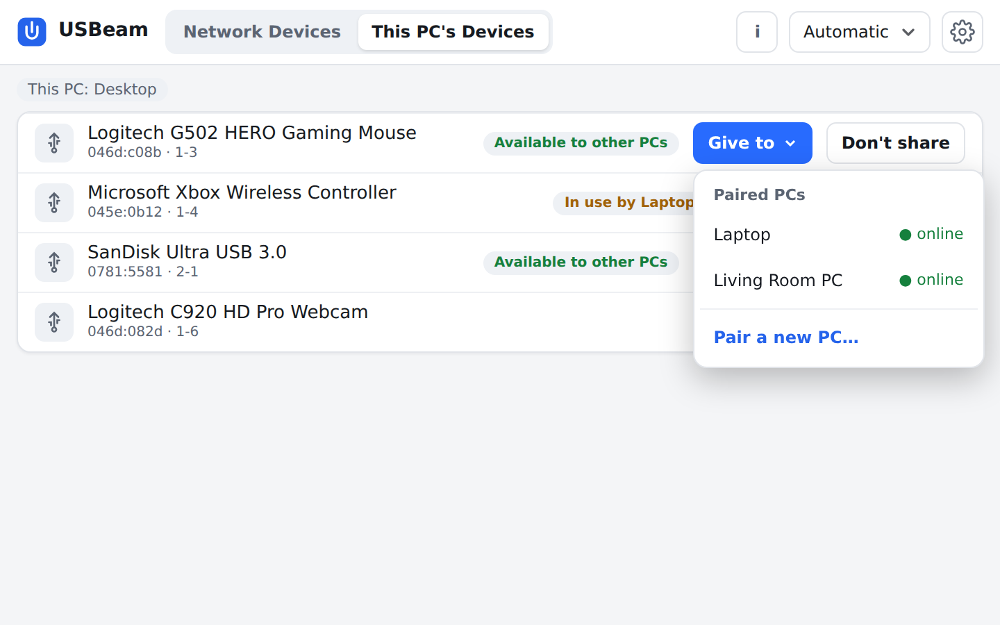
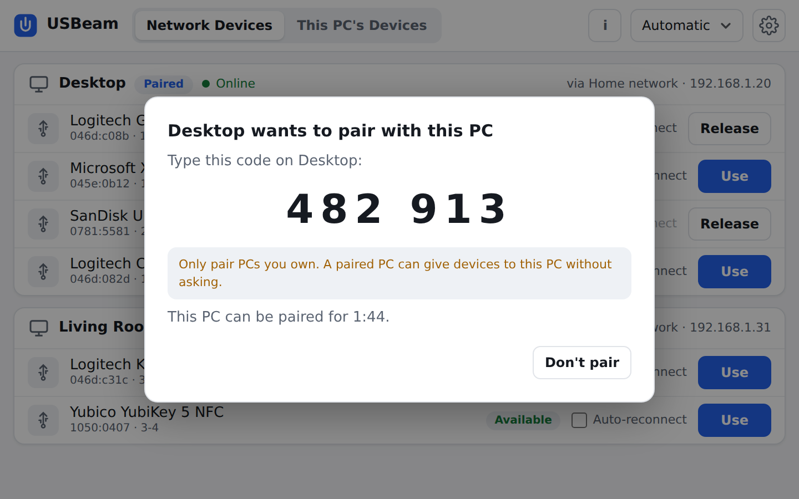
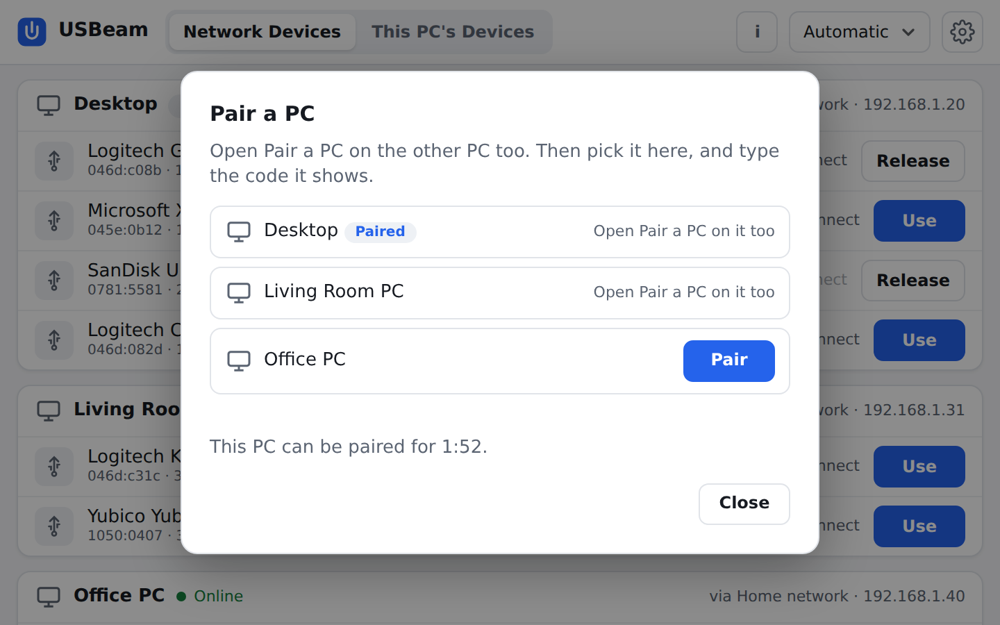
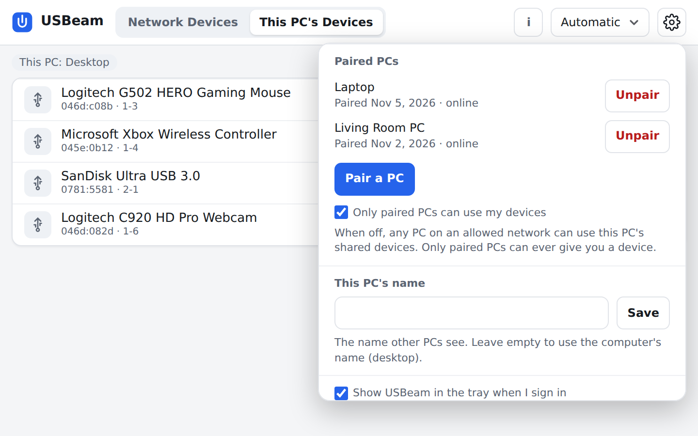
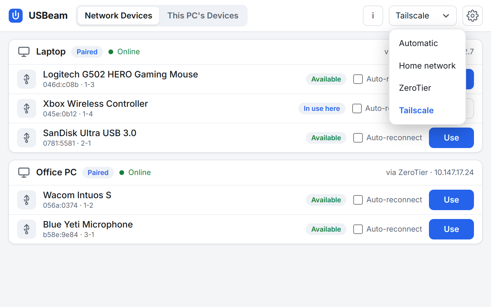
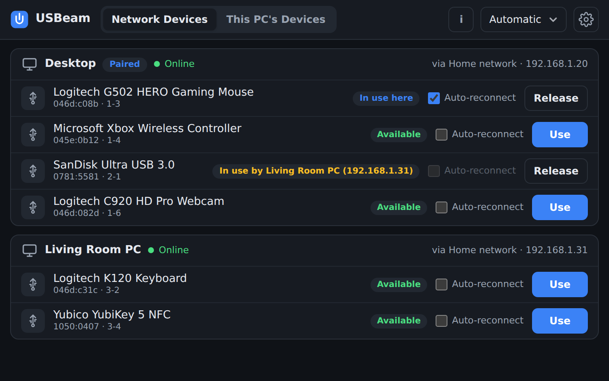

# USBeam

**Free, open-source USB over IP for Windows and Linux.**

Plug a USB device into one computer and use it on another over your network,
as if it were plugged in there. Mice, keyboards, game controllers, webcams,
drives, security keys: one click to use them on another PC, one click to give them back.

  

## What it does

- **Share and use devices.** Every installation can share its own USB devices
  and use devices shared by other computers. No device limits.
- **Give to.** Send a device from the PC it's plugged into straight to another
  PC you've paired with: it connects there right away, no clicks needed on the other side.
- **Pair your PCs** with a one-time 6-digit code. Paired PCs trust each other, and you can
  choose to let only paired PCs use your devices. Pairing is kept through updates.
- **Finds your computers by itself** on your home network, and over ZeroTier or
  Tailscale when you're away.
- **Simple app, no terminal.** A window and a tray icon, light and dark theme. USBeam starts
  with your computer and stays out of the way.
- **Auto-reconnect** (optional) brings a device back after sleep or a network drop.
- **Open standard.** Uses USB/IP, so it also works with Linux's built-in USB/IP
  support and with [usbip-win2](https://github.com/vadimgrn/usbip-win2).

## Screenshots

| | |
|:---:|:---:|
|  **Give to** a paired PC |  **Pairing:** type the code the other PC shows |
|  **Pair a PC:** pick the other PC |  **Paired PCs** and "Only paired PCs" in settings |
|  **Connect over** your home network, ZeroTier or Tailscale |  **Dark theme** |

## Safeguards

- **Your system drive is off-limits.** A USB drive your running system lives on is never shown,
  shared or touched.
- **Drives aren't shared unless you choose to share them.** The same goes for Bluetooth/wireless
  adapters and RGB lighting controllers. A drive with files open is never taken away.
- **Network adapters are never shared**, so USBeam can't cut off your own connection.
- **Devices come back.** A shared device returns to its own PC when it's released, unplugged or
  the other PC disconnects. If the network drops, it's freed within about 20 seconds.
- **A clean handover every time.** A device is reset right before it goes to another PC, so it
  works there even if it was busy (a mouse being moved, for example) at that moment.
- **Pairing is secure.** The 6-digit code is random and never an easy one, works only for a
  couple of minutes and allows 3 tries. It is turned into a key with CPace, a password-based key
  exchange chosen by the IRTF crypto forum: listening on the network reveals nothing.
- **Hardware scan only touches empty USB ports**, never ones with a device on them.
- **Open source (GPL-3.0)**, and every release is built and tested automatically on GitHub.
- **Use it only on networks you trust**: device traffic itself isn't encrypted.

## Download

See [Releases](../../releases):

- **Windows** (Intel/AMD and ARM): `USBeam-Setup-<version>.exe`
- **Linux** (most distributions with systemd): `USBeam-<version>-x86_64.AppImage`

## Installing

**Windows:** run `USBeam-Setup-<version>.exe` and follow the steps.

**Linux (AppImage):** no terminal needed.

1. Download `USBeam-<version>-x86_64.AppImage`.
2. Right-click the file → **Properties** → **Permissions**, and tick **Allow executing file as
   program** (in some file managers: **Is executable**).
3. Double-click the file, click **Install**, and enter your password.

USBeam then starts with your computer, appears in your application menu, and updates itself
from its settings menu (the gear icon). There you can also turn off starting with the computer,
quit USBeam or uninstall it.

## Pairing two PCs

1. On both PCs, open USBeam → gear icon → **Pair a PC**.
2. On one of them, pick the other PC and click **Pair**.
3. Type the 6-digit code the other PC shows.

That's it: the two PCs stay paired, also after updates. **Give to** (in **This PC's Devices**)
now lists the other PC.

## License

USBeam is free software: you can redistribute it and/or modify it under the
terms of the **GNU General Public License, version 3 or (at your option) any
later version**. See [LICENSE](LICENSE). USBeam includes Monocypher (2-clause BSD / CC0) for pairing.
